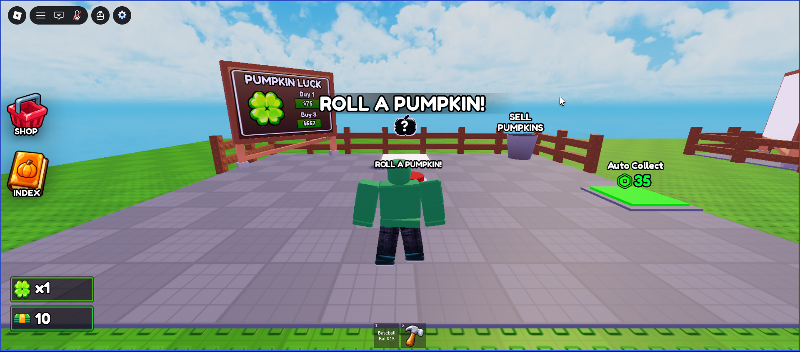
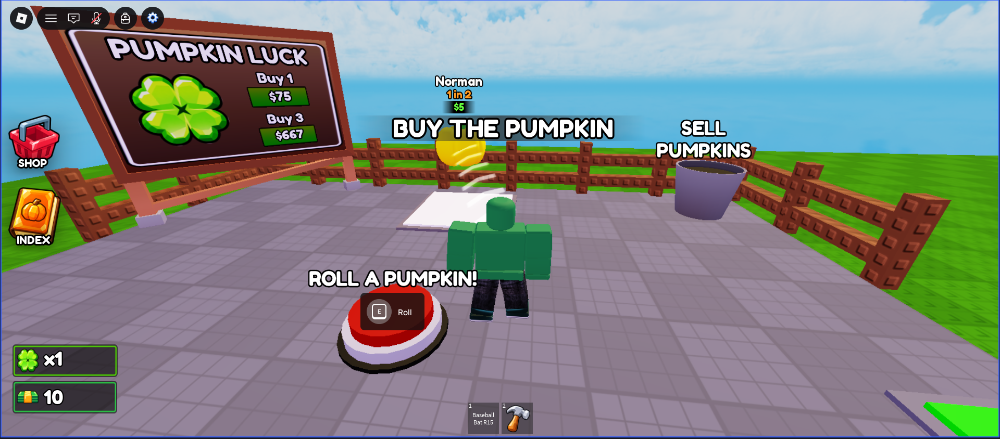
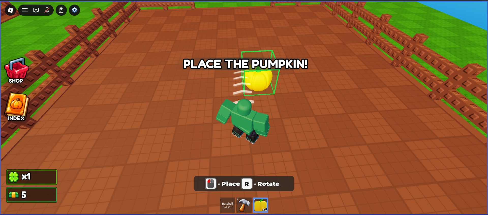
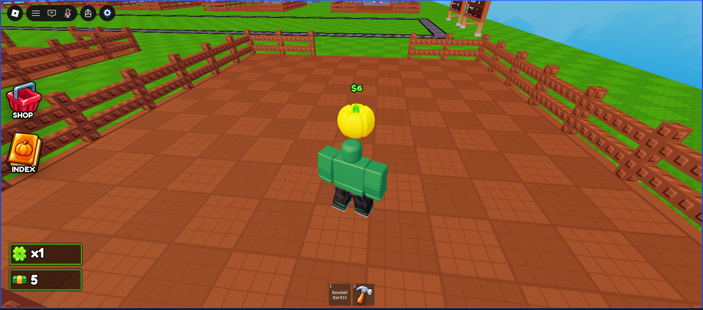
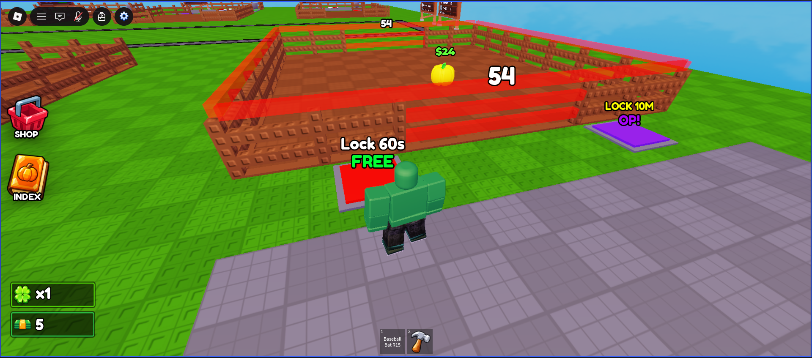
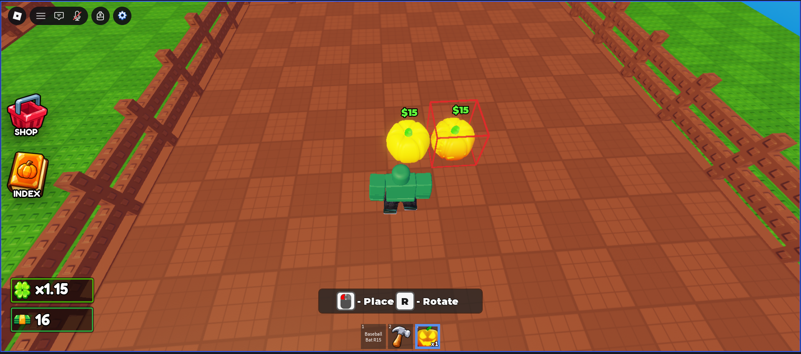
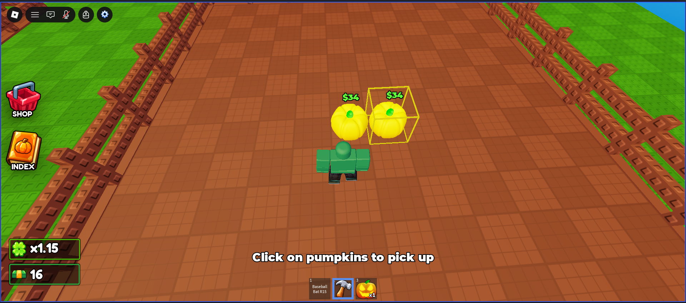
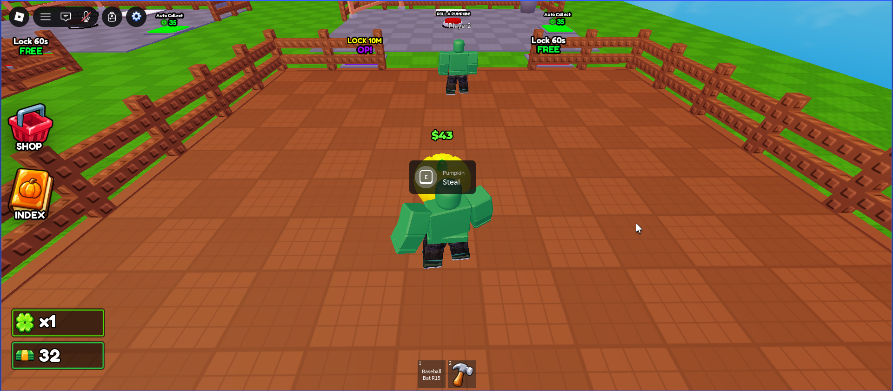

**Pumpkin RNG** 
is a multiplayer Roblox game built with **Roblox Studio** and **Luau**. Players roll for pumpkins, buy them, and place them on their own plots. Placed pumpkins generate money over time, which players can collect and use to progress. Players can also defend their plots with barriers or attempt to steal pumpkins from others.



## Play the Game

Play [Pumpkin RNG on Roblox](https://www.roblox.com/games/96643977079347/Pumpkin-RNG).

## Gameplay

- **Roll and buy pumpkins:** Roll to reveal a pumpkin, then decide whether to purchase it.
- **Place pumpkins:** Use a grid-based placement preview on your assigned plot. Green indicates a valid location; red indicates a blocked location.
- **Earn money:** Placed pumpkins generate money over time. Collect earnings to purchase more pumpkins and upgrades.
- **Upgrade luck:** Improve the chance of rolling rarer pumpkins.
- **Manage your inventory:** Store pumpkins and use tools such as the hammer to pick up placed pumpkins.
- **Protect your plot:** Activate barriers to prevent other players from entering and stealing pumpkins.
- **Steal pumpkins:** Attempt to carry a pumpkin from another player's plot to your own. If the thief is hit or leaves, or the original owner leaves before the theft is completed, the pumpkin returns to its original position.
- **Save progress:** Player progression and placed pumpkins can be restored across sessions.

## Tutorial

New players are guided through the main gameplay loop:

1. Roll a pumpkin.
2. Purchase the rolled pumpkin.
3. Select it from the inventory and place it on the plot.







## Gameplay Screenshots

| Feature | Screenshot |
| --- | --- |
| Plot barrier |  |
| Invalid placement preview |  |
| Hammer pickup mode |  |
| Stealing another player's pumpkin |  |

## Technologies

| Technology | Purpose |
| --- | --- |
| **Roblox Studio** | Building the game world, plots, models, and interfaces. |
| **Luau** | Implementing gameplay, server-side systems, and client-side controllers. |
| **Roblox DataStoreService** | Persisting player progression between sessions. |
| **RemoteEvents** | Supporting communication between client and server scripts. |
| **Purse** | Third-party inventory and hotbar interface library. |

## Source Code

The `src/` directory contains the game's **Luau scripts**, organized to reflect their locations in Roblox Studio:

```text
src/
├── ReplicatedStorage/
│   ├── Config/
│   └── Modules/
├── ServerScriptService/
├── StarterPlayer/
│   └── StarterPlayerScripts/
└── StarterGui/
```

The repository includes the gameplay scripts and UI LocalScripts but does **not** include every Roblox Studio instance, model, visual UI component, or RemoteEvent. It is intended to showcase the game's source code and architecture, rather than provide a complete place file that can be run without additional setup.

### Third-party dependency: Purse

The game uses **[Purse](https://purse.luau.page/)** for its inventory and hotbar interface. **Purse's library source code is not included in this repository.** The game-specific `PumpkinPurseAdapter` integration is part of the project's own source code.

## Documentation

- [Game Overview](docs/01-Game-Overview.md) — Gameplay mechanics and the player experience.
- [System Architecture](docs/02-System-Architecture.md) — Project structure, services, client/server responsibilities, and persistence.
- [Gameplay Systems](docs/03-Gameplay-Systems.md) — Technical descriptions of rolling, placement, income, stealing, and barriers.

## AI Assistance

The Luau code for Pumpkin RNG was written with assistance from **ChatGPT (OpenAI)**. The game was developed, integrated, tested, and iterated on in Roblox Studio.
pkin-RNG-README.md…]()
