# 01 — Game Overview

## About Pumpkin RNG

**Pumpkin RNG** is a multiplayer Roblox game where players roll for pumpkins, purchase them, and place them on their own plots to generate money.

Each pumpkin has its own probability of being rolled, purchase price, and income generation rate. Players can grow their collections, upgrade their luck, and interact with other players through plot protection and pumpkin stealing.

**Play the game:** [Pumpkin RNG on Roblox](https://www.roblox.com/games/96643977079347/Pumpkin-RNG)

## 1. Getting Started

When a player joins Pumpkin RNG, they are assigned one of eight available plots.

New players are introduced to the game through a tutorial that guides them through three essential actions:

1. Roll for a pumpkin.
2. Purchase the rolled pumpkin.
3. Place the pumpkin on their plot.

### Step 1 — Roll a Pumpkin

The tutorial first directs the player toward the Roll a Pumpkin button.

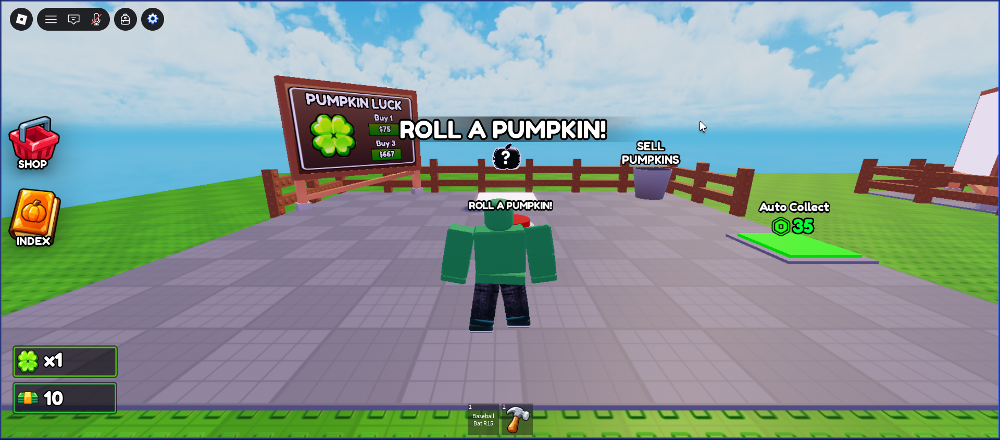

After interacting with the button, a rolling sequence plays and a pumpkin is selected.

The player can see the pumpkin and its information before deciding whether to purchase it.

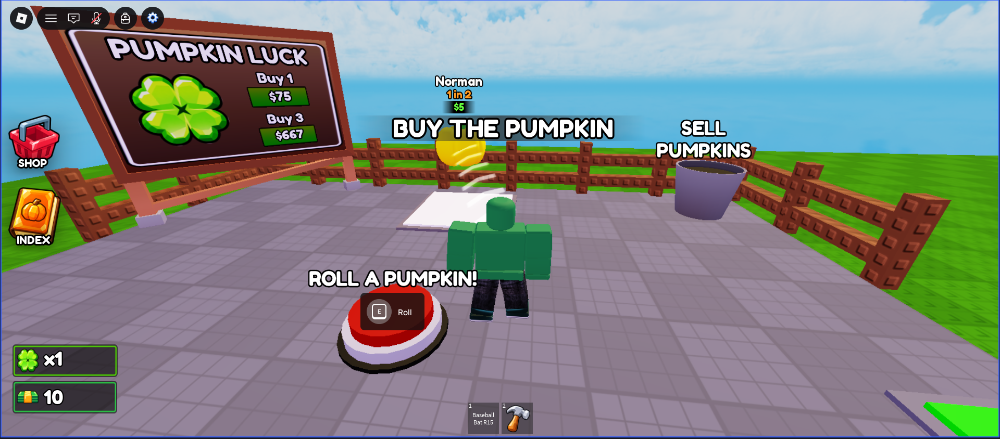

### Step 2 — Purchase the Pumpkin

After rolling a pumpkin, the tutorial directs the player to purchase it.

Purchased pumpkins are added to the player's inventory, where they can be selected for placement.

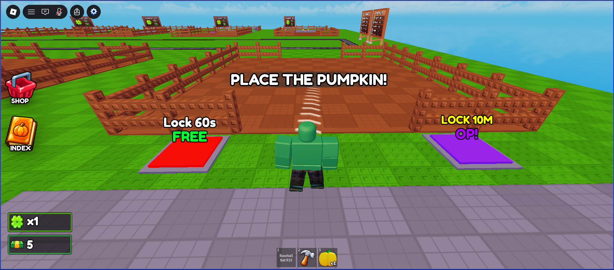

### Step 3 — Place the Pumpkin

When the player selects a pumpkin from their inventory, they enter placement mode.

A transparent placement preview shows where the pumpkin will be positioned on the plot.

A green outline indicates that the selected location is valid.

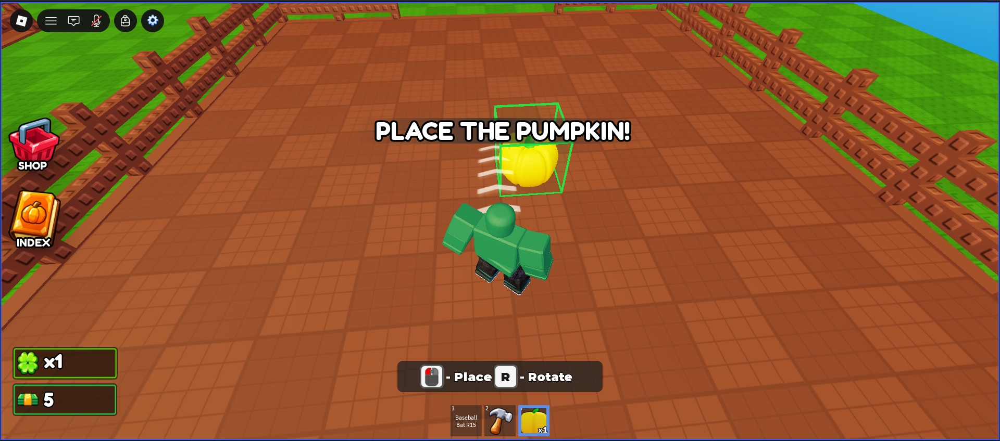

Once the pumpkin is placed, the introductory tutorial is completed.

The placed pumpkin begins generating money over time.

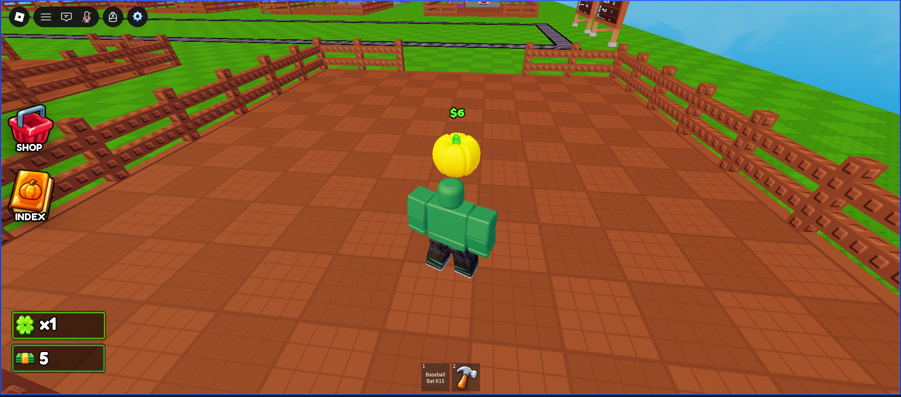

## 2. Pumpkin Rolling

Players obtain pumpkins through a random rolling system.

Each pumpkin has configurable gameplay properties, including:

- A unique identifier.
- A display name.
- A probability or draw weight.
- A purchase price.
- An income generation rate.
- A placement size.

Some pumpkins are more difficult to obtain than others.

Players can upgrade their luck to improve their chances of obtaining rarer pumpkins.

## 3. Grid-Based Placement

Each player's plot provides an area where purchased pumpkins can be placed.

The placement system uses a grid to keep pumpkins aligned and prevent overlapping objects.

### Valid Placement

When the selected location is available, the placement preview displays a green outline.

### Invalid Placement

When a player attempts to place a pumpkin in an occupied location, the placement preview displays a red outline.

The player must choose a different location before placing the pumpkin.

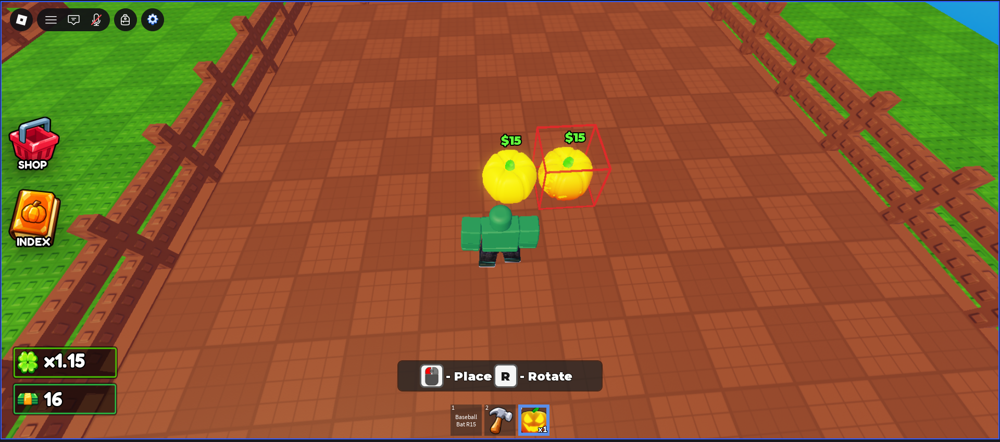

### Picking Up Pumpkins

Players can equip a hammer to enter pickup mode.

In this mode, a yellow outline identifies the pumpkin that can be picked up.

This allows players to reorganize their plots and move pumpkins to different positions.

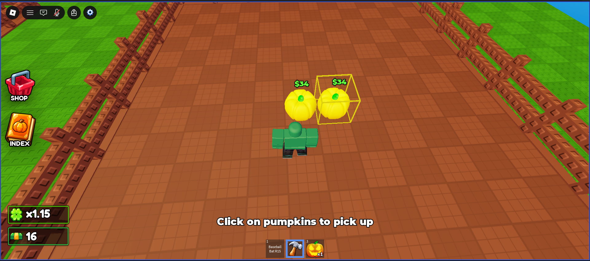

## 4. Passive Income

Placed pumpkins generate money over time.

Each pumpkin has an income generation rate determined by its configuration.

The money generated by a pumpkin accumulates until the player collects it.

Players collect the accumulated money by walking over the pumpkin's collection area.

The collected money can then be used to purchase more pumpkins and upgrade their luck.

## 5. Plot Protection

Players can protect their pumpkins by activating a barrier around their plots.

When active, the barrier prevents other players from entering the protected area.

The game includes two barrier options:

- **Standard Barrier:** Activated using the plot's lock button.
- **Extended Barrier:** A 20-minute barrier that can be purchased using Robux.

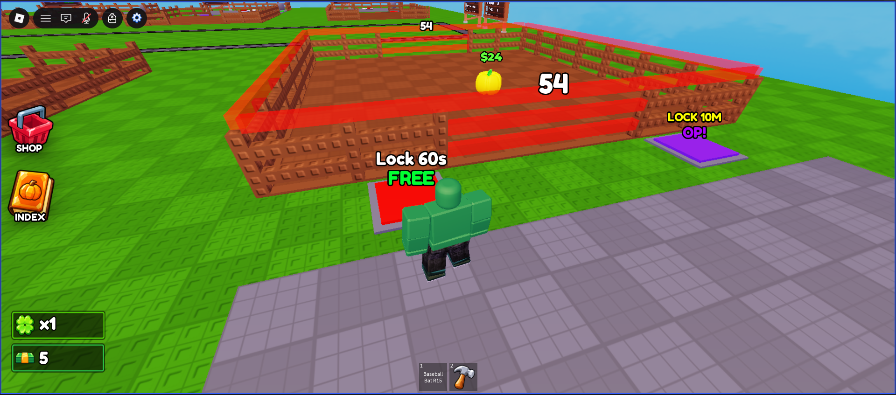

Plot protection adds an additional element of strategy because players must decide when to protect their collections.

## 6. Pumpkin Stealing

Pumpkin RNG allows players to interact competitively by attempting to steal pumpkins from other players.

When a plot is unprotected, another player can enter and approach a placed pumpkin.

The player can then initiate the stealing interaction.

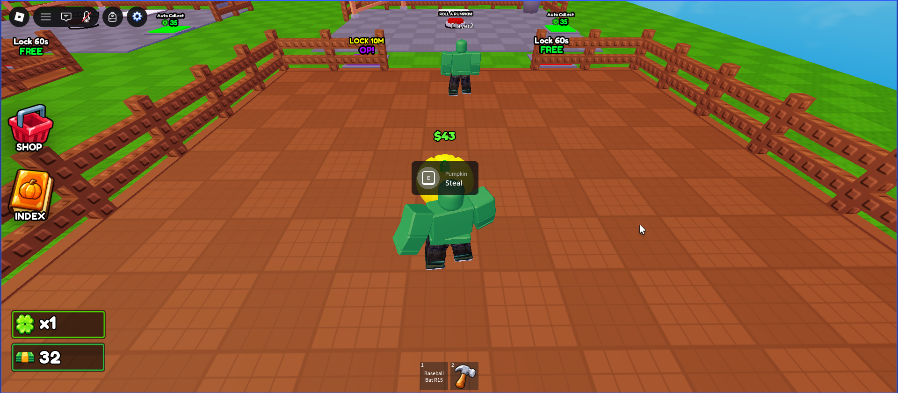

After picking up a stolen pumpkin, the player must transport it back to their own plot.

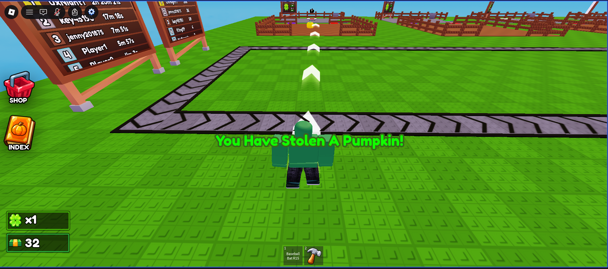

The original owner can see that their pumpkin is being stolen.

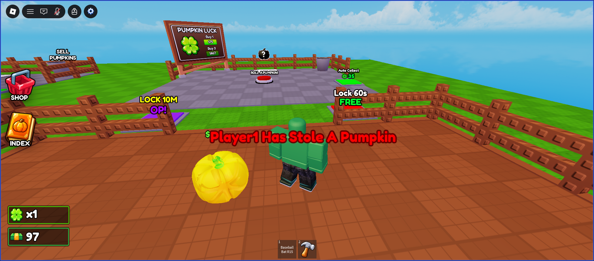

A stolen pumpkin does not immediately become the thief's property.

The stealing process is completed only when the player successfully brings the pumpkin into their own plot.

If the stealing attempt is interrupted before completion, the pumpkin returns to its original owner.

## 7. Inventory Management

Players have an inventory system for managing purchased pumpkins and gameplay tools.

The inventory includes:

- A baseball bat used for player interactions.
- A hammer used for picking up placed pumpkins.
- Purchased pumpkins waiting to be placed.

Pumpkins of the same type can stack in the inventory.

Players can select pumpkins from their inventory to enter placement mode.

## 8. Player Progression

Progression in Pumpkin RNG revolves around growing the player's pumpkin collection.

The general gameplay loop is:

1. Roll for a pumpkin.
2. Purchase the pumpkin.
3. Place it on the player's plot.
4. Collect its generated income.
5. Purchase additional pumpkins.
6. Upgrade luck to improve future rolls.
7. Expand and protect the collection.

As players progress, they can obtain pumpkins with different probabilities and income values.

## 9. Data Persistence

Pumpkin RNG includes a player data persistence system.

Player progression is saved between sessions, allowing players to return to the game without losing their saved progress.

Saved information includes relevant progression data such as currency, upgrades, inventory, and placed pumpkins.

When a returning player joins the game, their saved information is used to restore their progression.

## Gameplay Preview

[Play Pumpkin RNG on Roblox](https://www.roblox.com/games/96643977079347/Pumpkin-RNG)

## Technical Documentation

This document describes the gameplay experience.

For details about the Luau implementation, including the rolling system, grid placement, inventory management, stealing mechanics, and persistence, see:

- [System Architecture](02-System-Architecture.md)
- [Gameplay Systems](03-Gameplay-Systems.md)
