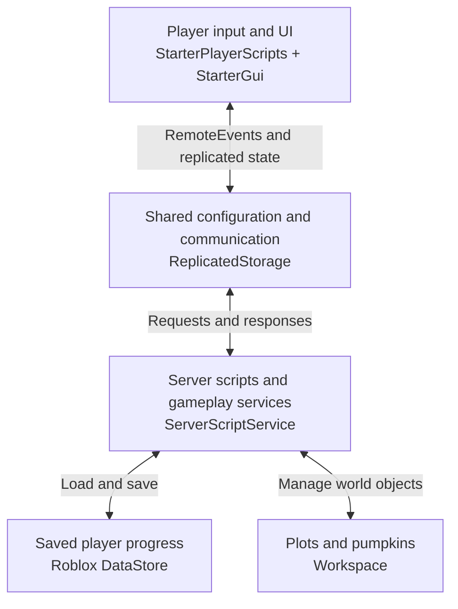
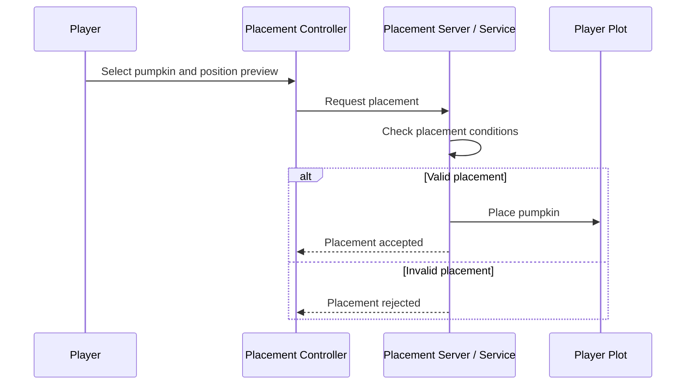

# System Architecture — Pumpkin RNG

Pumpkin RNG is a multiplayer Roblox experience developed in **Roblox Studio** using **Luau**. Its code separates shared game configuration, server-side gameplay services, client-side controls, and interface scripts. This document describes that organization and the interactions between its major systems.

For the player-facing rules and screenshots, see [01-Game-Overview.md](01-Game-Overview.md).

## 1. Architecture at a Glance



The server coordinates persistent player progress and multiplayer gameplay. Client scripts manage player input, visual feedback, and interfaces. Shared configuration and RemoteEvents live in `ReplicatedStorage`, making them available to the relevant client and server scripts.

This is a **logical architecture diagram**: it summarizes responsibilities rather than claiming that every interaction uses one specific RemoteEvent.

## 2. Roblox Studio Project Structure

The following is a condensed view of the actual game hierarchy. The source code is organized using the Roblox service containers rather than one flat set of scripts.

```text
ReplicatedStorage/
├── Config/
│   ├── GameConfig
│   ├── LuckConfig
│   ├── PlayerDataTemplate
│   ├── PumpkinConfig
│   ├── RarityConfig
│   └── RollConfig
├── Modules/
│   ├── NumberFormatter
│   └── PumpkinGridUtil
├── Remotes/
│   ├── Barrier/
│   │   ├── CancelPremiumBarrierPurchase
│   │   ├── CancelUnlockBasePurchase
│   │   ├── PromptPremiumBarrierPurchase
│   │   ├── PromptUnlockBasePurchase
│   │   ├── ShowBarrierIsActive
│   │   └── ShowPlayerBarrierUnlocked
│   ├── InventoryRequest
│   ├── InventoryUpdated
│   ├── PlacePumpkinRequest
│   └── PlacementResult
└── Purse

ServerScriptService/
├── [Server scripts, e.g. PumpkinRollServer,
│    PumpkinPlacementServer, PumpkinStealServer,
│    BarrierServer, PlayerDataBootstrap]
└── [Service modules, e.g. PumpkinRollService,
     PumpkinPlacementService, PumpkinStealService,
     BarrierService, PlayerDataService, PlotService]

StarterPlayer/
└── StarterPlayerScripts/
    ├── BarrierController
    ├── BarrierPromptController
    ├── GameSettingsClient
    ├── HammerPickupController
    ├── LuckUpgradeController
    ├── PlayerFeedbackController
    ├── PumpkinPlacementController
    ├── PumpkinStealController
    └── RollController

StarterGui/
├── IconsScreenGui/ShopController
├── MostRollsScreenGui/MostRollsLeaderboardClient
├── OfflineEarningsScreenGui/OfflineEarningsController
├── PumpkinIndexScreenGui/PumpkinIndexController
├── SettingsGui/SettingsTopbarIcon
├── TestResourceScreenGui/CurrencyController
├── TopTimePlayedScreenGui/TopTimePlayedScreenGui
└── TutorialScreenGui/TutorialController
```

The full project also contains Roblox world objects such as plots, pumpkin models, buttons, and GUI elements. These are configured in Studio and are not represented by Luau filenames alone.

## 3. Shared Configuration and Utilities

`ReplicatedStorage/Config` centralizes values and definitions used by gameplay systems:

| Module | Purpose |
| --- | --- |
| `PumpkinConfig` | Pumpkin definitions, including identifiers, prices, income rates, roll weights, model names, and placement dimensions. |
| `RarityConfig` | Rarity definitions and presentation-related settings. |
| `RollConfig` | Settings for the pumpkin rolling experience. |
| `LuckConfig` | Player luck upgrades and related values. |
| `GameConfig` | Shared game-wide settings, including income-related configuration. |
| `PlayerDataTemplate` | Default structure for persistent player data. |

`Modules/PumpkinGridUtil` supplies reusable grid-related logic, while `Modules/NumberFormatter` formats numeric values for display. `Purse` is the inventory/backpack library integrated through the game's `PumpkinPurseAdapter`.

Keeping these definitions separate from the gameplay handlers makes balancing and updating pumpkin properties easier without changing every system that uses them.

## 4. Server-Side Organization

`ServerScriptService` contains both running **server scripts** and reusable **service modules**. The distinction is important: the `*Server` files serve as entry points for runtime behavior, while modules such as `PumpkinRollService` contain reusable gameplay operations. Exact initialization and event wiring vary by feature.

### Core services

| Service | Responsibility |
| --- | --- |
| `PlayerDataService` | Loading, reconciling, saving, and releasing persistent player profiles. |
| `PlotService` | Finding available plots, assigning owners, teleporting players, and releasing plots. |
| `PumpkinRollService` | Calculating roll probabilities, generating offers, purchasing offered pumpkins, and cleaning up active offers. |
| `PumpkinPlacementService` | Placement rules and processing for pumpkins placed on a player's plot. |
| `PumpkinIncomeService` | Registering placed pumpkins, processing generated income, and collecting stored earnings. |
| `PumpkinStealService` | Tracking reserved pumpkins and in-progress thefts, including cancellation and cleanup. |
| `BarrierService` | Managing normal and premium plot barriers and their active states. |
| `PumpkinPurseAdapter` | Connecting the game's pumpkin inventory to the Purse interface. |

Additional modules cover currency (`CurrencyService`), inventory (`PumpkinInventoryService`), luck (`LuckService`), discoveries (`PumpkinIndexService`), offline earnings (`OfflineEarningsService`), collecting (`AutoCollectService`), purchases (`ShopPurchaseService` and `BarrierPurchaseService`), selling (`PumpkinSellService`), player tools (`PlayerToolService`), tutorial progress (`TutorialService`), player feedback (`PlayerFeedbackService`), analytics (`GameAnalyticsService`), and runtime cleanup (`PlayerRuntimeCleanup`).

The corresponding server scripts include `CurrencyServer`, `PumpkinRollServer`, `PumpkinPlacementServer`, `PumpkinStealServer`, `PumpkinPickupServer`, `PumpkinInventoryServer`, `PumpkinIndexServer`, `PumpkinIncomeBootstrap`, `BarrierServer`, `BarrierPurchaseServer`, `LuckServer`, `OfflineEarningsServer`, `AutoCollectServer`, `TutorialServer`, `PlayerFeedbackServer`, `GameSettingsServer`, `GameSettingsPersistenceServer`, `PlayerDataBootstrap`, the two leaderboard servers, and inventory test-button code.

This division lets multiple features use shared operations without duplicating their core logic in each server entry point.

## 5. Client-Side Organization

### Gameplay controllers

The scripts in `StarterPlayerScripts` handle local interactions and presentation. For example:

- `RollController` supports the player's roll interaction and results display.
- `PumpkinPlacementController` handles placement-mode input and visual previews.
- `HammerPickupController` supports picking up pumpkins with the hammer tool.
- `PumpkinStealController` supports the theft interaction from the player's perspective.
- `BarrierController` and `BarrierPromptController` manage barrier-related client feedback and prompts.
- `LuckUpgradeController`, `GameSettingsClient`, and `PlayerFeedbackController` handle their respective player-facing features.

### Interface controllers

`StarterGui` contains LocalScripts associated with individual interfaces rather than one large all-purpose UI controller. These include the shop, currency display, pumpkin index, offline earnings, tutorial, settings, and leaderboards (`MostRollsLeaderboardClient` and the time-played interface script).

The client can show previews and respond immediately to input, but persistent gameplay changes must ultimately be processed by the appropriate server systems.

## 6. Client–Server Communication

The project places RemoteEvents in `ReplicatedStorage/Remotes` for communication between client and server code. Two explicitly named placement events are:

1. `PlacePumpkinRequest` — the client-side placement flow requests an action.
2. `PlacementResult` — the server-side flow communicates the placement outcome back to the player.

The inventory has `InventoryRequest` and `InventoryUpdated` events. The `Barrier` subfolder contains events for purchase prompts, cancellation, and barrier status messages.

For a **typical placement interaction**, the responsibilities are:



The visible preview communicates valid and blocked positions (green and red respectively). This diagram illustrates the responsibility split; precise validation steps and payload fields are defined by the individual scripts.

## 7. Key Gameplay Interactions

### Rolling and buying

`PumpkinRollService` exposes operations for building a probability table, requesting a roll, buying an active offer, and cleaning up player state. Pumpkin definitions and luck-related configuration are kept separate from these operations. The player sees the rolled pumpkin before deciding whether to purchase it.

### Placement and income

The player places a purchased pumpkin on their assigned plot using a grid-based preview. A placed pumpkin can then be registered with `PumpkinIncomeService`, which processes income and supports individual or collective collection. The income service also contains specific handling for money accrued before a pumpkin is picked up.

### Plot ownership

`PlotService` keeps runtime mappings of players to plots and plots to owners. It assigns an available plot, provides access to the plot's floor and placed-pumpkin folder, moves the player to their spawn location, and releases the plot on departure.

### Barriers and stealing

`BarrierService` tracks plot barriers, including normal and premium states. A locked barrier prevents unauthorized entry while active.

`PumpkinStealService` tracks pumpkin reservations and active thefts. A stolen pumpkin becomes the thief's only after reaching the thief's own plot. If the thief is hit or leaves before completing the theft—or the original owner leaves—the pumpkin is returned to its original position. This prevents an interrupted theft from being treated as a successful ownership transfer.

## 8. Player Data and Persistence

`PlayerDataService` is the central persistence module. The supplied implementation uses Roblox `DataStoreService` and `PlayerDataTemplate` and includes several safeguards:

- **Default-data reconciliation:** Existing profiles can be supplemented with newly introduced default fields.
- **Version migration support:** A migration structure supports future changes to saved data.
- **Session identification and locking:** Profiles are associated with a server session to reduce competing session writes.
- **Retries:** DataStore operations can be retried after transient failures.
- **Periodic saving:** The implementation uses a **60-second autosave interval**.
- **Release on exit:** Player profiles can be saved and released when players leave.

Persistent progression includes currency, luck, pumpkins, discoveries, storage-related progress, purchases, and tutorial completion. Runtime objects such as an occupied plot and its physical pumpkin models are managed separately and can be reconstructed from saved player data when the player returns.

The server also includes `PlayerRuntimeCleanup` to coordinate the removal of player-specific runtime state. This distinction between **persistent data** and **temporary world/session state** is central to avoiding stale plot ownership or objects after a player leaves.

## 9. Design Summary

The main architectural choices visible in the supplied code are:

| Pattern | How it is used |
| --- | --- |
| **Config-driven behavior** | Pumpkin properties, rarity, luck, and other settings live in shared configuration modules. |
| **Service-based server logic** | Gameplay operations are grouped by responsibility rather than embedded in one monolithic script. |
| **Client/server separation** | Controllers and GUI scripts handle player-facing interactions; server scripts and services process shared game state. |
| **Event-based communication** | RemoteEvents connect client requests with server-side gameplay flows and player feedback. |
| **Persistent profiles plus runtime cleanup** | Saved player progression is handled separately from temporary plot assignments, live pumpkins, and in-progress interactions. |

This document covers the supplied project structure and inspected core services. It does not attempt to reproduce every implementation detail of the UI scripts or every event connection. Those details belong in the corresponding Luau source files and feature-specific gameplay documentation.
