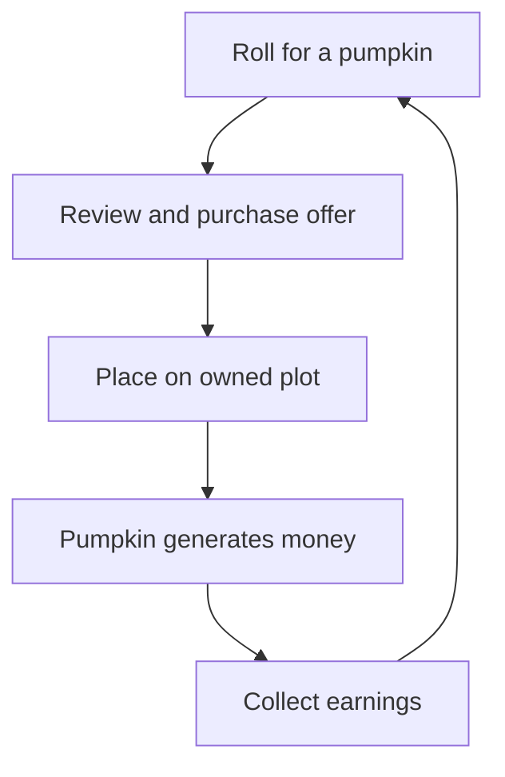
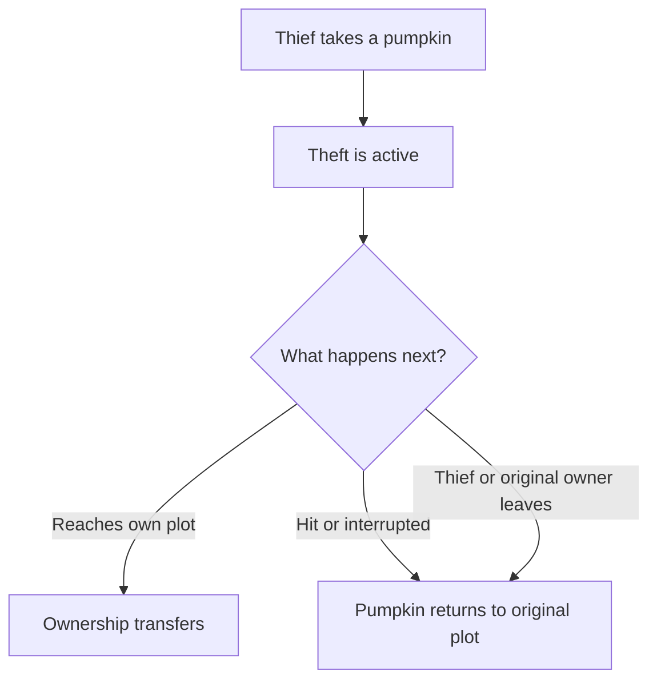

# Gameplay Systems — Pumpkin RNG

This document explains the gameplay systems in **Pumpkin RNG**, a multiplayer Roblox experience built with Luau. It focuses on how players interact with the systems and how the main server-side modules coordinate them.

For the overall code layout, see [02-System-Architecture.md](02-System-Architecture.md). For a player-facing walkthrough and screenshots, see [01-Game-Overview.md](01-Game-Overview.md).

## 1. Core Gameplay Loop

Players repeatedly roll for pumpkins, purchase them, place them on their personal plot, and collect the money those pumpkins generate. Earnings can be used to obtain more valuable pumpkins and improve progression. Players can also defend their plots with barriers or attempt to steal pumpkins from other players.

The roll-and-buy flow, placement system, income system, and inventory are separate code responsibilities, but they work together to create this loop.

## 2. Player Plots

The game supports **eight player plots**. `PlotService` manages ownership and access to each plot's important world objects.

When a player joins, the game can assign an available plot, teleport the character to its spawn position, and associate the player with that plot for the current session. Placed pumpkins are kept within that plot's `PlacedPumpkins` folder.

The service maintains two runtime lookup tables: one from **player to plot** and another from **plot to owner**. It also provides functions for determining plot ownership, retrieving the plot floor, and releasing a plot when its owner leaves.

Plot ownership matters for placement, collection, defenses, and stealing: a player should not be able to place their own pumpkins on another player's land.

**Relevant modules:** `PlotService`, `PlayerRuntimeCleanup`, `PlayerDataService`.

## 3. Pumpkin Rolling and Purchasing

### Rolling

The player interacts with the roll button to start a roll animation and reveal a pumpkin. The result is presented as an offer, allowing the player to review its properties before buying it.

The `PumpkinRollService` module contains the main server-side operations:

| Function | Role |
| --- | --- |
| `GetProbabilityTable()` | Builds probabilities for pumpkins using the current luck multiplier. |
| `GetProbabilityTotal()` | Calculates the probability total for the generated table. |
| `RequestRoll()` | Processes a player's request to roll. |
| `GetActiveOffer()` | Retrieves the player's current outstanding offer. |
| `BuyOffer()` | Processes purchase of a particular offer. |
| `CleanupPlayer()` | Removes temporary roll-related state on player cleanup. |

Pumpkin definitions come from `PumpkinConfig`, while related balancing settings are separated into `RollConfig`, `RarityConfig`, and `LuckConfig`.

### Luck and probability

The game tracks a **luck multiplier**, which starts at **1.0** and can increase through upgrades. Luck affects the probabilities used when selecting pumpkins; it does not require changing every pumpkin's underlying configuration each time the player upgrades.

The supplied implementation builds a probability table for non-fallback pumpkins and handles a designated fallback pumpkin separately. The exact probability formula is maintained in `PumpkinRollService`; it should be consulted when changing balancing values rather than assuming that every rarity receives the same multiplier.

### Purchasing

The player must purchase the offered pumpkin to add it to their inventory. `BuyOffer()` checks that the offer exists and that its identifier matches the attempted purchase. It also uses a per-player **purchase-busy guard** to prevent overlapping purchase processing.

These checks help keep offers and purchases consistent when a player clicks repeatedly or sends multiple requests in quick succession.

**Relevant modules:** `PumpkinRollService`, `PumpkinConfig`, `LuckConfig`, `CurrencyService`, `PumpkinInventoryService`.

## 4. Pumpkin Inventory

Purchased pumpkins are stored in the player's inventory until they are placed or otherwise used. The interface uses the **Purse** inventory library, integrated with the game's data through `PumpkinPurseAdapter`.

The hotbar also includes gameplay tools:

- **Baseball Bat:** Used to hit another player, including a player carrying a stolen pumpkin.
- **Hammer:** Puts the player into pickup mode for managing placed pumpkins.

Pumpkins of the same type can appear as stacks in the inventory. Inventory updates are coordinated with server-side inventory state and displayed through the client interface.

The project separates the inventory's underlying data from its presentation. That separation is important when a player leaves and later rejoins: saved items must be restored to the gameplay data and reflected in the interface.

**Relevant modules:** `PumpkinInventoryService`, `PumpkinPurseAdapter`, `PlayerToolService`; shared `Purse` library; `InventoryRequest` and `InventoryUpdated` RemoteEvents.

## 5. Grid-Based Pumpkin Placement

After purchasing a pumpkin, the player selects it to enter **placement mode**. A translucent preview follows the intended location on the player's plot.

| Preview | Meaning |
| --- | --- |
| **Green outline** | The selected pumpkin can be placed at this location. |
| **Red outline** | Placement is blocked, for example because a pumpkin already occupies the space. |
| **Yellow outline** | The hammer is targeting a placed pumpkin for pickup. |

The system uses a grid based on **3 × 3 × 3 stud cells**. Pumpkin definitions can occupy different grid widths and depths; a longer pumpkin therefore reserves more space than a small one.

The client-side `PumpkinPlacementController` handles input and preview presentation. `PumpkinGridUtil` provides shared grid-related calculations, while the server-side `PumpkinPlacementServer` and `PumpkinPlacementService` process placement requests. The project exposes `PlacePumpkinRequest` and `PlacementResult` RemoteEvents for the placement flow.

Placement rules include:

1. The player must have a plot available for their pumpkin.
2. The location must be within the player's permitted plot area.
3. Grid cells required by the pumpkin must not overlap occupied cells.
4. The selected pumpkin's dimensions and rotation must be taken into account.
5. A successful placement updates the world object and the relevant player state.

The result is a predictable, grid-aligned layout that works for different pumpkin sizes. Placement previews are a usability feature; the server-side placement process remains responsible for accepting or rejecting the action.

**Relevant modules:** `PumpkinPlacementController`, `PumpkinPlacementServer`, `PumpkinPlacementService`, `PumpkinGridUtil`, `PlotService`.

## 6. Passive Income and Collection

Once placed, pumpkins generate money over time. Each pumpkin type defines its own **money per second** value in `PumpkinConfig`.

The `PumpkinIncomeService` module maintains the gameplay-side operations involved in income:

| Function | Purpose |
| --- | --- |
| `RegisterPumpkin()` | Starts tracking a placed pumpkin for earnings. |
| `UnregisterPumpkin()` | Stops tracking a pumpkin when it is removed or otherwise leaves income generation. |
| `ProcessIncome()` | Processes accumulated income for tracked pumpkins. |
| `Collect()` | Collects money from a particular pumpkin. |
| `CollectAll()` | Collects multiple eligible amounts. |
| `GetTotalStoredMoney()` | Returns money currently accumulated but not yet collected. |
| `CollectBeforePickup()` | Handles accumulated money before a pumpkin is picked up. |

The game displays money accumulated above pumpkins. Players can collect earnings by walking over the relevant pumpkin or collection area. Auto-collection and offline-earnings features are handled by their own services, allowing those mechanics to remain separate from the core income calculations.

**Relevant modules:** `PumpkinIncomeService`, `CurrencyService`, `AutoCollectService`, `OfflineEarningsService`, `PumpkinConfig`.

## 7. Plot Barriers

Barriers let players temporarily prevent other players from entering their plots and stealing pumpkins. The game provides both a normal barrier interaction and a **premium 20-minute barrier** available through a Robux purchase.

`BarrierService` handles plot-specific barrier state. Its supplied interface includes:

- `InitializePlot()` and `BindPlayerToPlot()` for connecting barrier state with plots and owners.
- `ActivateNormal()` and `ActivatePremium()` for barrier activation.
- `IsNormalLocked()`, `IsPremiumLocked()`, and `IsLocked()` for reading current state.
- `ForceUnlockNormal()` and related status functions for the unlock mechanic.
- `RestorePlayerBarrier()` and `CleanupPlayer()` for restoring or clearing player-associated state.

Purchase prompts and status feedback are communicated to client-side barrier controllers through RemoteEvents in `ReplicatedStorage/Remotes/Barrier`.

The main principle is that barrier state belongs to the plot/player gameplay system; the client-facing buttons and prompts reflect that state.

**Relevant modules:** `BarrierService`, `BarrierPurchaseService`, `BarrierServer`, `BarrierPurchaseServer`, `BarrierController`, `BarrierPromptController`.

## 8. Stealing Pumpkins

Players can enter another player's **unlocked** plot and attempt to steal a placed pumpkin. Stealing is deliberately treated as an **in-progress transaction**: picking up a pumpkin is not the same as becoming its owner.

This return behavior is confirmed for the published game:

- If the carrier is **hit** before completing the theft, the pumpkin returns to its original plot position.
- If the **thief leaves or disconnects**, the pumpkin returns.
- If the **original owner leaves** while the theft is active, the pumpkin returns rather than transferring to the thief.
- Only reaching the thief's **own plot** completes the ownership transfer.

`PumpkinStealService` contains functions for reserving pumpkins, querying active thefts, releasing reserved pumpkins, cancelling thefts, and clearing player-related theft state. These operations allow the game to distinguish a pumpkin that is still available from one already involved in an attempted theft.

**Relevant modules:** `PumpkinStealService`, `PumpkinStealServer`, `PumpkinStealController`, `PlotService`, `BarrierService`.

## 9. Tutorial and Player Feedback

New players are introduced to the core loop through a short tutorial:

1. **Roll:** Interact with the red roll button.
2. **Buy:** Purchase the pumpkin produced by the roll.
3. **Place:** Select the purchased pumpkin and place it on the plot.
4. **Complete:** Continue playing with the full gameplay loop available.

The tutorial changes its on-screen instructions as each step is completed. In the supplied rolling code, an active tutorial also restricts rolling when the player is not on the expected roll step; this prevents skipping ahead by rolling again before completing the required action.

Tutorial progress is stored with player data so players do not need to repeat completed onboarding every time they join. Other interfaces show purchase feedback, currency, discoveries, settings, offline earnings, and leaderboard information.

**Relevant modules:** `TutorialService`, `TutorialServer`, `TutorialController`, `PlayerFeedbackService`, `PlayerFeedbackController`.

## 10. Saving Progress and Cleaning Up

The game saves player progression, including currency, luck, inventory, placed pumpkins, discoveries, purchases, storage-related progress, and tutorial state.

`PlayerDataService` manages persistent profiles using Roblox DataStore operations. The supplied implementation includes data reconciliation, retries, session locks, **60-second autosaving**, and a profile-release operation for player departures.

When a player leaves, runtime cleanup releases their plot and removes or resets temporary objects and interactions. That matters for multiplayer correctness: plot ownership, live pumpkin instances, active barriers, and unfinished thefts should not continue to reference a departed player.

When the player later rejoins, saved progression can be restored, including previously placed pumpkins.

**Relevant modules:** `PlayerDataService`, `PlayerDataBootstrap`, `PlayerRuntimeCleanup`, `PlotService`, `PumpkinPlacementService`.

## 11. Source Code Reference

| Feature | Main Luau files |
| --- | --- |
| Rolling and purchases | `PumpkinRollServer`, `PumpkinRollService`, `RollController`, `PumpkinConfig` |
| Luck | `LuckServer`, `LuckService`, `LuckUpgradeController`, `LuckConfig` |
| Inventory | `PumpkinInventoryServer`, `PumpkinInventoryService`, `PumpkinPurseAdapter`, `Purse` |
| Placement and pickup | `PumpkinPlacementServer`, `PumpkinPlacementService`, `PumpkinPlacementController`, `PumpkinPickupServer`, `HammerPickupController` |
| Income and collection | `PumpkinIncomeBootstrap`, `PumpkinIncomeService`, `CurrencyService`, `AutoCollectService` |
| Barriers | `BarrierServer`, `BarrierService`, `BarrierPurchaseServer`, `BarrierPurchaseService` |
| Stealing | `PumpkinStealServer`, `PumpkinStealService`, `PumpkinStealController` |
| Tutorial | `TutorialServer`, `TutorialService`, `TutorialController` |
| Saving and cleanup | `PlayerDataBootstrap`, `PlayerDataService`, `PlayerRuntimeCleanup`, `PlotService` |

This document describes player-confirmed behavior and the inspected central service modules. It intentionally avoids inventing unverified client RemoteEvent payloads or internal implementations for modules whose source was not supplied.
